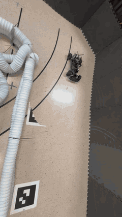
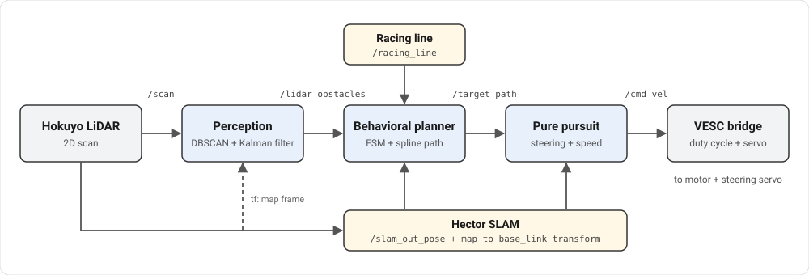

# F1/10 LiDAR Obstacle Avoidance System

<p align="center">
  <br>
  <em>Demo: the F1/10 car driving through an obstacle course (top-down view).
  <a href="assets/demo.mp4">Full video (mp4)</a></em>
</p>

This ROS project implements a pipeline for autonomous obstacle avoidance and overtaking on an F1/10 race car, using only 2D LiDAR data. The system detects, tracks, and classifies obstacles as static or dynamic, and uses that to decide how to drive around them.

The repository contains the three software nodes (perception, behavioral planner, path-following controller) and the rest of the pipeline for a real car: hardware bring-up, VESC bridge and odometry, loop-closing mapping (slam_toolbox), AMCL localization, and an offline racing line planner.

## System Architecture

<p align="center">
  
</p>

The system is modular: perception, planning, and control are separate nodes, which makes it easy to debug and extend.

| Node | File | Subscribes | Publishes |
|------|------|-----------|-----------|
| Perception | `nodes/lidar_perception.py` | `/scan`, tf | `/lidar_obstacles` |
| Behavioral planner (FSM) | `nodes/behavioral_planner_fsm.py` | `/lidar_obstacles`, `/racing_line`, pose | `/target_path` |
| Pure pursuit controller | `nodes/pursuit_controller.py` | `/target_path`, pose | `/cmd_vel` |
| VESC bridge | `nodes/cmdvel_to_vesc.py` | `/cmd_vel` | `/commands/motor/duty_cycle`, `/commands/servo/position` |
| Waypoint recorder | `nodes/waypoint_recorder.py` | pose | CSV file |
| Racing line publisher | `nodes/racing_line_publisher.py` | CSV file | `/racing_line` |

In the launch files, "pose" is `/pose` (`geometry_msgs/PoseStamped`), published by `pose_relay.py` from the AMCL tf (map → base_link).

-----

## How It Works

### 1. Detection: clustering

The perception node projects the raw `/scan` into a point cloud, transforms it into the map frame, and groups the points into individual "objects."

  * **Algorithm:** DBSCAN (scikit-learn), a density-based clustering on Euclidean distance. Points closer than `clustering_eps` are linked into one cluster; clusters with fewer than `clustering_min_samples` points are treated as noise.
  * **Output:** For each cluster, the centroid and its bounding-box size.
  * **Wall filter:** Clusters larger than `max_obstacle_size` (default 1.5 m) are ignored, so long track walls are not mistaken for obstacles.

### 2. Tracking & Classification: Kalman Filter

Detections are tracked over time to estimate each obstacle's motion.

  * **Data association:** Each track is matched to the nearest new detection (within 1 m).
  * **Prediction and update:** A constant-velocity Kalman filter with state $[x, y, v_x, v_y]$ predicts the position and is corrected by the matched detection.
  * **Classification:** From the filtered speed:
      * below `classification_static_threshold` (default `0.1 m/s`) → **STATIC**
      * above `classification_dynamic_threshold` (default `0.2 m/s`) → **DYNAMIC** (an opponent vehicle)
      * in between → **UNKNOWN**

### 3. Decision & Action: Finite State Machine (FSM)

The behavioral planner decides which behavior to run, based on the classified obstacles ahead of the car.

  * **`LANE_FOLLOWING` (default):** Follow the global path from `/racing_line`. Switches to `AVOID_STATIC` or `OVERTAKE_DYNAMIC` when an obstacle is detected ahead.
  * **`AVOID_STATIC`:** Shifts the racing line sideways around the obstacle (smooth ramp in, hold, ramp out). The passing side is chosen from the map: the side with more room.
  * **`OVERTAKE_DYNAMIC`:** Predicts the opponent's position `overtake_prediction_time` seconds ahead from its estimated velocity, and plans a path around that predicted position.

The pure pursuit controller then follows `/target_path` and outputs a speed and a steering angle on `/cmd_vel`.

-----

## Pipeline

```
LiDAR ──> slam_toolbox (loop closure) ──> map                                  mapping
map ────> AMCL ──> /pose                                                       localization
map ────> plan_racing_line.py ──> racing line (x, y, speed)                    path planning
racing line + /pose + LiDAR ──> perception ──> FSM ──> pure pursuit ──> VESC   racing + obstacle avoidance
```

Built for ROS Noetic with a Hokuyo LiDAR and a VESC on a 1/10 scale car.

## Acknowledgements

  * Hardware setup follows the 2025 Summer RCPSL F1/10 project: [youngwc7/RCPSL-F1-10](https://github.com/youngwc7/RCPSL-F1-10).
  * Motor control uses [f1tenth/vesc](https://github.com/f1tenth/vesc) (BSD-3-Clause).
  * Mapping: [slam_toolbox](https://github.com/SteveMacenski/slam_toolbox); localization: ROS `amcl`; driver: `urg_node`.
